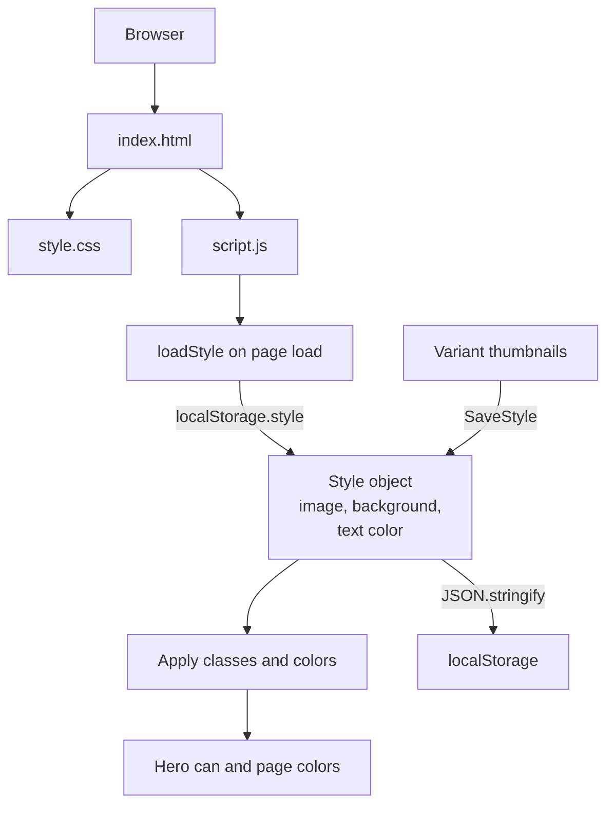
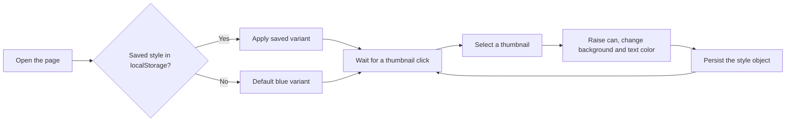

<div align="center">


<p><strong>A product landing page where selecting a can swaps the hero image and the page color theme.</strong></p>

</div>

<div align="center">

<a href="https://github.com/mohammed-laabidi/pepsi-landing-page"></a>
<a href="https://github.com/mohammed-laabidi/pepsi-landing-page/fork"></a>
<a href="https://github.com/mohammed-laabidi/pepsi-landing-page/issues"></a>


</div>

<div align="center">

<a href="https://mohammed-laabidi.github.io/pepsi-landing-page/"><strong>Live Demo</strong></a>
&nbsp;&nbsp;|&nbsp;&nbsp;
<a href="https://github.com/mohammed-laabidi/pepsi-landing-page">Repository</a>

</div>

## Overview

Pepsi Landing Page is an interactive product page built with plain HTML, CSS, and JavaScript. The hero presents a slogan, a short description, and a store link next to a large can photograph. Below the hero, a row of three thumbnails offers the blue, silver, and black variants.

Selecting a thumbnail does three things at once: the matching can is brought to the front, the background color changes to the variant color, and the text color switches to keep contrast. The chosen variant is written to `localStorage` and restored on the next visit, so the page opens with the last selection.

The project demonstrates state-driven styling without a framework: a small style object is applied to the document and persisted as JSON.

## Features

<table>
<tr>
<td width="50%" valign="top">


### Can switcher

Three thumbnails select the blue, silver, or black can, and the selected image is raised into view while the others move back.

</td>
<td width="50%" valign="top">


### Dynamic color theme

Each variant applies its own background color and a matching text color, so readability is preserved across the three themes.

</td>
</tr>
<tr>
<td width="50%" valign="top">


### Persistent selection

The current style object is serialized to `localStorage` and reapplied when the page loads.

</td>
<td width="50%" valign="top">


### Responsive composition

Two media queries rescale the hero typography, the can images, and the thumbnail row.

</td>
</tr>
<tr>
<td width="50%" valign="top">


### Layered can images

The three cans sit on top of each other, and visibility is controlled through opacity and position rather than separate pages.

</td>
<td width="50%" valign="top">


### Header navigation

Home, Products, What's New, Newsletter, and Contact entries are rendered above the hero.

</td>
</tr>
</table>

## Technology Stack

<div align="center">


</div>

| Technology | Purpose |
| --- | --- |
| HTML5 | Header, hero, thumbnails, and footer markup |
| CSS3 | Layered cans, theme transitions, and media queries |
| JavaScript | Variant selection, style application, and persistence |
| Web Storage API | `localStorage` key holding the selected style |
| GitHub Pages | Static hosting of the live demo |

## Architecture

The page keeps a single style object that is applied to the document elements when a can is selected and restored from storage on load.



### Style state

| Field | Description |
| --- | --- |
| Selected image | Identifier of the active can (`pepsi1`, `pepsi2`, or `pepsi3`) |
| Background color | Page background applied for the variant |
| Text color | Text color chosen for contrast on that background |

## Application Flow



## Project Structure

```text
pepsi-landing-page/
├── index.html
├── style.css
├── script.js
├── img/
│   ├── pepsi-black.png
│   ├── pepsi-blue.png
│   ├── pepsi-logo.png
│   └── pepsi-silver.png
└── README.md
```

## Getting Started

### Prerequisites

A modern browser. No dependencies or build step are required.

### Installation

```bash
git clone https://github.com/mohammed-laabidi/pepsi-landing-page.git
cd pepsi-landing-page
```

Open `index.html` in a browser, or serve the folder locally:

```bash
python -m http.server 8000
```

## Usage

1. Select one of the three thumbnails under the hero.
2. Observe the can image, background color, and text color change together.
3. Reload the page: the last selection is restored from `localStorage`.
4. Clear site data to return to the default appearance.

## Deployment

The live demo is hosted on GitHub Pages from the repository root. Any static host can serve the folder without configuration.

## Author

<table>
<tr>
<td valign="top">

**Mohammed Laabidi**

<a href="https://github.com/mohammed-laabidi"> GitHub</a>
&nbsp;&nbsp;
<a href="https://www.linkedin.com/in/mohammed-laabidi-793a40436"> LinkedIn</a>
&nbsp;&nbsp;
<a href="mailto:mohammedlaabidi19@gmail.com"> Email</a>

</td>
</tr>
</table>

---

If this project is useful to you, consider giving the repository a star.
